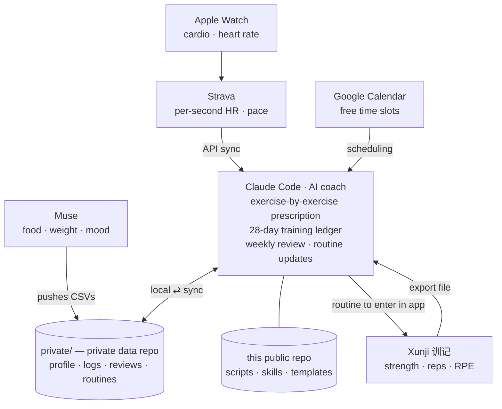

# Fitness Coach

A file-based personal training system run with Claude Code.
Data flows in automatically (or with one export), Claude reviews every session,
and the plan is updated in plain Markdown — no copying numbers by hand.

```
collect data  ->  review each session  ->  update the routine
```

This repository holds only the **code, skills and templates**. Your personal
data (profile, medical history, logs, reviews) lives in a **separate private
repository** cloned into `private/`, which this repo git-ignores.

## Architecture



| Source | What it gives | How it gets here |
|---|---|---|
| Apple Watch → Strava | Runs, HR, pace, splits | `scripts/strava_sync.py` (Strava API) |
| **Xunji (训记)** | Strength sets, weight, reps, RPE | Export from the app → `private/inbox/xunji/` → `scripts/import_xunji.py` |
| Muse | Meals, daily calories / protein, body weight, mood | Muse commits to the private repo — see [`template/docs/muse-data-contract.md`](template/docs/muse-data-contract.md) |
| Scale (manual) | Body weight | `scripts/log_weight.py` |
| Google Calendar | When and where you can train | Claude's Google Calendar connector |

### Why Xunji works differently from Hevy

Hevy has a paid public API, so a Hevy setup can let Claude read workouts and
write routines directly. Xunji has no public API, so this repo uses a
**file round-trip** instead:

1. **In:** after a session, export your records from Xunji and drop the file in
   `private/inbox/xunji/`. The importer normalises it into
   `private/data/strength/sets.csv` (deduplicated, so re-exporting your whole
   history is fine).
2. **Out:** Claude writes routines to `private/plan/routines/*.md` in a layout
   that mirrors Xunji's template screen (exercise, sets × reps, load, rest), and
   you enter or update the template in the app.

## Layout

```
CLAUDE.md                   Coach instructions — Claude reads this first
.claude/skills/             Claude Code skills (see below)
scripts/                    Stdlib-only Python helpers
scripts/samples/            Example Xunji exports for testing the importer
template/                   Empty skeleton of the private data repo
private/                    Your private data repo (git-ignored here)
  profile/                    Stats, medical history, goals, targets.json
  plan/program.md             Current training block
  plan/routines/              One file per routine, per location/equipment set
  data/body-weight.csv        Daily weigh-ins
  data/body-composition.csv   DEXA and smart-scale scans
  records/                    Original scan reports (PDF)
  data/strength/sets.csv      Normalised strength log (from Xunji)
  data/cardio/activities.csv  Runs and other cardio (from Strava)
  data/nutrition/meals.csv    Every food item (from Muse)
  data/nutrition/daily.csv    Daily calories / macros (from Muse)
  data/wellbeing/mood.csv     Mood, energy, stress, sleep (from Muse)
  inbox/xunji/                Raw Xunji exports
  reviews/                    Session and weekly reviews
  docs/                       Data contracts (what Muse writes where)
```

## Setup

1. Clone this repo, then create your **private** data repo from the template:

   ```bash
   git clone https://github.com/RitterRen/fitness-coach.git && cd fitness-coach
   cp -R template private && cd private && git init -b main && git add -A && git commit -m "Start data repo"
   gh repo create fitness-data --private --source . --push && cd ..
   ```

   If you already have a data repo, clone it instead:
   `gh repo clone <you>/fitness-data private`. To keep it somewhere else, set
   `FITNESS_DATA_DIR`.
2. Fill in `private/profile/athlete.md`, `medical-history.md`, `goals.md` and
   the numbers in `targets.json`.
3. Open the repo in Claude Code and ask it to draft `private/plan/program.md`
   and your first routines with you.
4. Strava (optional): create an API app at <https://www.strava.com/settings/api>
   (Authorization Callback Domain: `localhost`), copy `.env.example` to `.env`,
   fill in the client ID and secret, then run `python3 scripts/strava_sync.py --auth` once.
5. Muse (optional): give Muse write access to the **private** repo only and
   point it at `docs/muse-data-contract.md` there.
6. Connect Google Calendar in Claude if you want schedule-aware planning.

Python 3.9+ only; no packages to install.

## Daily use

```bash
python3 scripts/log_weight.py 72.4              # log today's weight
python3 scripts/import_xunji.py                 # import everything in private/inbox/xunji/
python3 scripts/strava_sync.py                  # pull new Strava activities
python3 scripts/weekly_report.py --days 28      # 28-day training ledger, checked against your targets
python3 scripts/race_fitness.py                 # VDOT, race predictions, training paces
```

## Skills

The repo ships its own Claude Code skills in `.claude/skills/`. They load
automatically when you open the repo in Claude Code, either by name
(`/session-review`) or when what you say matches them.

| Skill | Use it when |
|---|---|
| `log-weight` | `/log-weight 72.4` — log a weigh-in, see the 7-day trend |
| `session-review` | You finish a lift or run: pull data, compare with the plan, set next targets |
| `weekly-review` | End of week: 7- and 28-day summary, plan next week around your calendar |
| `xunji-import` | You exported from Xunji, or the importer does not recognise a column |
| `routine-builder` | New or changed routine for a location / equipment set, ready to copy into Xunji |
| `goal-check` | "Am I on track?" — body fat (DEXA), race target, weekly lifts and miles, loss rate, protein, sleep |
| `body-comp-import` | A new DEXA or smart-scale report: pull it from iCloud Drive, store it privately, log and compare it |

## Privacy

Nothing personal is committed to this repository. Health data, logs and
reviews stay in `private/`, which must be a **private** repository.
`.env` (API tokens) is git-ignored.
